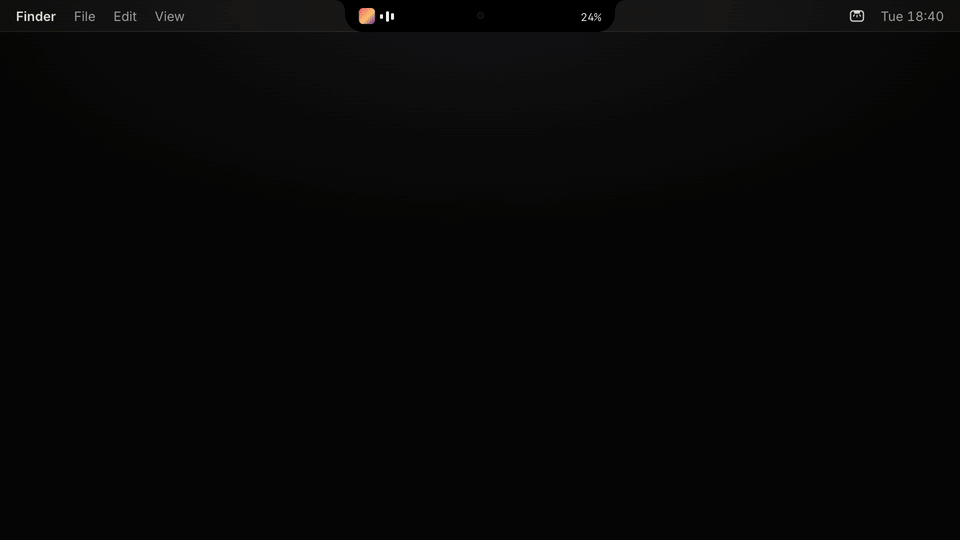

# OpenNotch

[](docs/media/opennotch.mp4)

<sub>Music: “We Love Tech House (Instrumental Mix)” by Hasenchat, [Jamendo](https://www.jamendo.com/track/1246299), [CC BY 3.0](https://creativecommons.org/licenses/by/3.0/).</sub>

A native macOS notch app. Hovering the notch expands it into a panel showing a
now-playing card with play/pause/next/previous, live progress scrubber, and
source badge, driven through a small plugin API (`OpenNotchKit`) so the notch UI
never touches MediaRemote directly.

## Running

### Packaged app (recommended)

```bash
./Scripts/make-app.sh
open build/OpenNotch.app
```

Produces a double-clickable, ad-hoc-signed `build/OpenNotch.app` with the
MediaRemote adapter embedded in its Resources — launch it from anywhere (Finder,
`open`) and now-playing streams. This is the path that makes "Launch at Login"
work correctly.

### Dev mode

```bash
swift build
swift run OpenNotch
```

This launches an agent app (no Dock icon, `.accessory` activation policy).
A status bar item appears with a menu. In dev mode the bridge resolves the
adapter from `vendor/mediaremote-adapter/`, so `swift run` must be invoked from
the package root.

## Tests

```bash
swift test
```

Runs the logic-core test suite (`OpenNotchKitTests`) — pure logic, no UI or
live MediaRemote dependency.

## Definition of Done (M2) — manual checklist

Walk this on a physical MacBook with a notch, running `build/OpenNotch.app`
launched from Finder (not the repo root):

- [ ] Hover notch → expands with a bouncy spring; hover out → snappy close.
- [ ] Rapid hover in/out mid-animation retargets smoothly — no loop, no dead zone.
- [ ] Clicks land on apps behind the transparent window margins.
- [ ] Click the notch/panel → pins open (hover-out keeps it open); click
      anywhere else → unpins.
- [ ] Drag a file over the notch → panel expands; drag away → collapses.
- [ ] Play/pause/next/previous work; progress bar advances live; drag it to seek.
- [ ] Source badge shows the playing app's icon.
- [ ] `pkill -f mediaremote-adapter` → stream recovers; kill it 3× fast →
      "Media unavailable" (no frozen stale card).
- [ ] External display: pill appears there; fullscreen on one display hides
      only that display's notch/pill.
- [ ] Unplug display / close lid → panels rebuild, no strays, no crash.
- [ ] Native fullscreen hides the notch immediately; YouTube in-window
      fullscreen hides it within ~1s; exiting restores it.
- [ ] Lock screen + unlock → notch returns.
- [ ] Launch at Login works from the bundled app.
